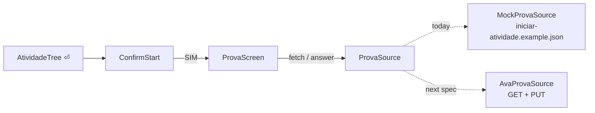

# Answering an atividade, against a mock

## TL;DR
- SIM on `ConfirmStart` stops toasting and pushes `ProvaScreen`, the app's own two panes: every question on the left, the one highlighted on the right with its alternativas. An atividade already started skips the confirmation.
- The questions come from `MockProvaSource`, which reads the captured `iniciar-atividade` response from disk. No request is sent, and every atividade shows the same ten questions.
- Answers and the start instant live in memory, keyed by atividade, for as long as the app runs; a clock counts up from it in the prova header and in a new `Tempo` column of the atividades tree. `uninter.db` is untouched.
- `Prova`, `Questao` and `Alternativa` are frozen dataclasses in `api/provas/` — the first entities here that are not tables.
- The mock is one file, one line in `main.py` and a `MOCK` tag on screen: the three things the next spec deletes.

[0014](../done/0014-atividade-start-confirmation.md) stopped at the confirmation because no start call was captured. It is captured now, but calling it opens a real attempt and spends a tentativa, so this spec builds the whole flow against the captured response and leaves the request to the spec after it. Context in [CONTEXT.md](../../CONTEXT.md); the no-capture rule in [0001](../done/0001-ava-atividades-crawler.md), the tree in [0012](../done/0012-grouped-atividades.md).

## Observed behaviour
Measured over `uninter-endpoints/atividades/iniciar-atividade.example.json`, the captured response of one APOL.
- It returns `avaliacaoUsuarioHistoricos`, one entry per question: `ordem`, `questao` and `comando` as HTML, and four `alternativas` whose text is `questaoAlternativaAtributos[0].valor`. Ten questions, all `idQuestaoTipo: 1`, four alternativas each.
- Nothing in the payload marks the correct alternative, and no submit call is captured. A grade cannot be computed here.
- The capture is mid-attempt: questions 1 and 8 already carry an `idQuestaoAlternativa`, the field a chosen alternative goes into.
- Eight tags appear in the whole payload: `p` 61, `strong` 10, `br` 14, `table`/`tr`/`td` 1/4/28, `ol`/`li` 1/5. `format.html_to_text` drops the `<ol>` numbering that question 5's alternatives ("1 – 2 – 4 – 3 – 5") point at, and flattens its `<table>` into one cell per line.
- Wrapped at 74 columns a question takes 4 to 17 lines, except question 5 at 101.
- 20 of the 151 atividades in `uninter.db` are `Aguardando início` and not presencial — the ones 0014's gate lets through.
- Textual offers a key to the focused widget, then the screen, then the App, so a screen binding shadows an App one. Read in the source; without it `q`, `r`, `j`, `d` and `1`–`3` stay live inside the prova.

## Decisions

### The mock replaces the request and nothing else
`ProvaSource` is a protocol with `async fetch(atividade) -> Prova`, `async answer(atividade, questao_id, alternativa_id)` and `async started_at(atividade) -> datetime | None`. `MockProvaSource` is its only implementation today: `fetch` parses the captured JSON through the same `ProvaDTO` the real source will use, `answer` writes to a dict. The next spec adds `AvaProvaSource` — the GET for `fetch`, the PUT `salvar-historico-resposta` for `answer`, `get-tempo-decorrido` for `started_at` — and changes one line in `main.py`. `fetch` is `async` although it reads a file, so that line is the only change.

### Nothing is persisted, and the last page says so
A prova is never written to `uninter.db`: the mirror keeps saying what the AVA says. A `resumo` row closes the question list; on it the right pane lists the alternative chosen for each question, an em dash for the unanswered ones, and the line that nothing was sent.

### Answers live in memory, keyed by atividade
`MockProvaSource` keeps `dict[atividade_id, dict[questao_id, alternativa_id]]` and seeds `fetch` from it, so leaving and reopening resumes — the same resume the AVA gives, since its own state is what the PUT per answer maintains. It dies with the process. The two selections in the capture are ignored: a prova opens blank.

### The prova is the matérias screen, with questions in the list
`ProvaScreen` repeats the app's layout, so nothing on it has to be learned twice: `QuestaoList` on the left under the same `border-right`, a detail pane on the right with `Header` and `Footer` above and below. A row is the question's first line with a `●` or `○`, and under it the alternativa chosen or `sem resposta`; the right pane is the question and its alternativas, the answered ones green as everywhere else that means done, the cursor the same bar the matérias use. The header pair matches `MateriaHeader`: the atividade and the matéria in bold, then a dim line with the position, whether it is answered, the clock and the `mock` tag, magenta like the tree's `presencial`. `cli/provas/html.py` renders the eight tags the payload uses — numbered `<ol>` items, a blank line per `
`, bold `<strong>`, `<table>` rows as aligned lines. `format.html_to_text` is left alone: the trabalhos etiqueta and the confirmation text already depend on what it does, and it writes the one-line preview each row of the list carries.

### The keys are the ones the matérias screen already taught
`↑`/`↓` on the left change the question, `→` or `⏎` enters the alternativas, `←` or `esc` comes back, `esc` on the list leaves — the step-back of [0011](../done/0011-tabbed-detail-panel.md). `↑`/`↓` then `⏎` answer, `a`–`d` answer from either pane, `1`–`9` and `0` jump to a question. `q`, `r` and `j` become no-ops so the app behind stays still; `q` quitting mid-prova is the one that matters, and the digits shadow the tab keys by doing something better.

### The clock counts up, and the confirmation happens once
`started_at` is stamped on the first `fetch`, which is what `iniciar-atividade` does at the AVA: it creates the attempt. From it, the prova header and a `Tempo` column in the tree count up every second — filled only for started atividades — and `ConfirmStart` is skipped for an atividade that already has one, because the confirmation creates the attempt and it exists.

### The mock announces itself and names its own removal
The header carries a `MOCK` tag for as long as the source is the mocked one. The mock is `crawler/atividades/prova_mock.py`, wired in one line of `main.py`, reading the capture that already documents the endpoint. No setting, no flag: a documented switch is a feature, and features do not get deleted.

## Rejected
- **An env flag choosing mock or real.** It needs the real request written now, and `UNINTER_MOCK_PROVA` in `.env.example` makes the mock a supported mode.
- **A copy of the capture under `src/`.** Two copies of the same 39 KB payload, free to drift; the mock reads the one that documents the endpoint.
- **A grade at the end.** No field marks the correct alternative, so any nota would be invented — and written into a mirror of the AVA.
- **Extending `format.html_to_text`.** One smarter function changes the trabalhos etiqueta and the confirmation text, which this spec never set out to touch.
- **A countdown from `tempo_total`.** It would expire against no authority; the clock counts up instead, which is what `get-tempo-decorrido` answers, and nothing here ends an attempt.
- **All ten questions in one scroll, or a list beside the question.** Question 5 buries the rest in the first; the second narrows the column exactly where its table needs width.
- **A framed panel of its own — rules, a progress strip, a key line, boxed.** Built and seen: it invented a second visual language for one screen, where the app already has panes, a dim header pair and a footer. An AUTOSAVE lamp in it would have named a save that happens nowhere.

## What execution corrected
- `ProvaDTO` was taken: it is already the AVA's `avaliacao` object inside the atividades list. The question DTOs are `QuestoesDTO`, `QuestaoDTO`, `AlternativaDTO` and `AtributoDTO`, in the same `crawler/atividades/dto.py`.
- `←` and `→` are not free keys: Textual binds them on every scrollable widget as "Scroll Left"/"Scroll Right", so the focused `OptionList` owns them and only lets them through because nothing scrolls sideways — and the footer advertised its hidden binding instead of ours. Both are `priority=True` now, like `pgup`/`pgdn`.
- The body is `height: 1fr` with the alternativas pinned under a top border. With `height: auto; max-height: 1fr` it measured against the whole screen, and question 5 left no rows for the alternativas at all.
- The real source needs `idAvaliacaoUsuario`, which nothing stores: in the atividades capture that field is `id` and it is `0` until an attempt exists — 154653964 in the capture here. The next spec has to create the attempt before it can ask for questions, which is the call that spends a tentativa.
- The `Tempo` column costs 9 columns of the tree: at 160 the row uses 108 of 112, and under about 150 the last columns crop, as they already did before it existed.
- The layout was built twice: one question per screen inside a frame, then this. The frame needed its body capped in Python — `max-height: 1fr` measures the whole screen, so question 5 pushed its own rules out — and the two panes need none of that, because `1fr` beside a list is what the app already does. Arriving at a question scrolls to the top only after the refresh, since focusing the alternativas posts a highlight that scrolls them into view after `show` returns.
- Verified headless at 110×34 and 160×34 over a copy of `uninter.db`, one App per scenario: the prova opens blank on question 1 of 10 with the `MOCK` tag; `c` and `↓`+`⏎` both answer and move the `●`; `→` ten times reaches the summary with nine em dashes and "Nada foi enviado ao AVA."; `←` returns to question 10; `q r j 1 2 3` change nothing and leave the app running; `esc` returns to the list and reopening resumes the answers; a presencial atividade still only toasts and a `Finalizada` one does nothing; the database file is byte-identical after answering; a missing capture toasts and pushes no screen. The clock ticks in both places, the strip marks answers as they are given, and reopening a started atividade skips `ConfirmStart` with the answers intact. `pyright` strict and `ruff` are clean.
