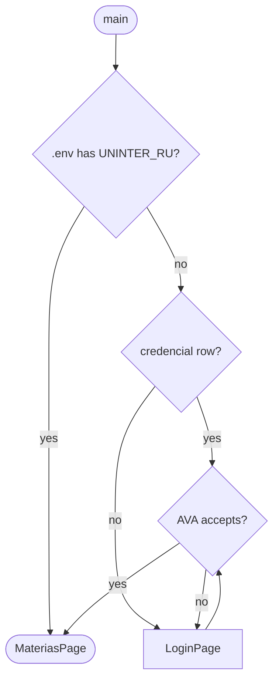

# The login page

## TL;DR
- `LoginPage` asks RU, senha and curso and authenticates before the app opens, so a rejection lands on the form instead of surfacing as a toast three screens later. Credentials it already has are tried behind the wave; the form is for when the AVA says no, or there is nothing to try.
- "Lembrar de mim" is the row itself — checked writes a `Credencial`, unchecked keeps the credentials in memory for that run.
- `.env` still wins. With `UNINTER_RU` set the page signs in by itself and steps aside, so what you do at startup is unchanged.
- The senha is stored as typed, and the reset takes it with the database: after `Invalidate cache` you log in again.
- `AvaSession` and `MateriaRequest` stop being handed credentials at construction and read a `Credenciais` holder the page fills.

[CONTEXT.md](../../CONTEXT.md) says credentials live in a `.env` nobody's code edits, which makes a hand-written file the price of opening the app at all. This spec makes the app able to ask, so a machine with no `.env` can reach the AVA — and keeps `.env` ahead of everything, so the machine that already has one notices nothing.

## Observed behaviour
- `AvaSession.__init__` and `MateriaRequest.__init__` take ru, senha and course_id in `main.py`, before `app.run_async()`: nothing can ask for them once the app is up.
- Login is lazy — `_session_headers` calls `_log_in` on the first request — so a wrong senha appears as a toast mid-sync, not at startup.
- `_log_in` posts directly and never builds a `Captura`. Its response carries the student's name and the session stamp.
- `schema_is_behind` skips a table SQLite does not have yet, so adding `credencial` does not recreate the database. Verified against a copy: it returns `False`.
- The reset unlinks `uninter.db` in `main.py`'s loop. Everything stored goes with it.

## Decisions

### `.env` wins, and the page is for its absence
The precedence is `.env`, then the stored row, then the form. `Settings` loses its required fields — `ru`, `password` and `course_id` become optional — so an absent `.env` is a state rather than a crash at `Settings.model_validate({})`.

### The page authenticates before the app opens
The form calls the AVA and stays put until it is accepted, which is what makes a typo answerable: the message lands under the field that caused it. Stored credentials go through the same gate, so a senha changed on the AVA's side reopens the page with the fields filled instead of failing at the first sync.

### The field is the `CursoId`, and `?` says where to find it
The AVA shows this number on no screen of its own — it is only in the URL of the call that builds the matérias list — so the form names the thing you go hunting for and binds `?` to the hunt. The modal is the four steps to the `SalaVirtual/<id>/CursoUsuarioPermissao` request, read off the capture in `uninter-endpoints/materias/`.

### The wave stands in for the form while the AVA is asked
A form you cannot type into is a worse way to say "wait" than the wave the app already uses for a sync, so `Loading` takes the screen for the length of the request and the form comes back only if there is something to answer. `Loading` gains a caption — `entrando no AVA` here, `buscando no AVA` everywhere else — and stays in `cli/components/` now that a second page calls it.

### Remembering is the row, not a column on it
Unchecked writes nothing; checked writes one `Credencial`. There is no `lembrar` boolean, because a row that records it was not meant to be kept is a row that was kept.

### The senha is stored as typed
The AVA needs the cleartext in the login POST at every startup, so what is stored has to be reversible into the password. It goes in `credencial.password` with no encoding: `uninter.db` is gitignored, and anyone who can read that file can read the senha.

### One `Credenciais` holder, read instead of copied
`AvaSession` and `MateriaRequest` read ru, senha and course_id from a holder rather than copying them at construction, so the page can fill it after the app is up. It also gives "logged out" one place to be true, instead of three `None`s in three constructors.

### The reset logs you out
`Invalidate cache` deletes the database and the row with it, and the app comes back on the login page. Its prompt already promises that everything stored goes; who is asking is now part of that.

### Logging out is a palette command
`Logout` deletes the row, clears the holder and asks again — the counterpart to remembering, and the only way to change RU without editing a file. `NO_MATERIAS` stops naming `.env` variables and points at it.

## Rejected
- **Hashing the senha.** One-way, and the AVA needs the cleartext in the login POST — storing a hash means never logging in again.
- **The OS keyring, encrypting at rest, or typing the senha every startup.** The first two are real protection for a disk image or a stray commit, at the cost of a dependency and a backend that is missing on a bare tty; the third protects everything and remembers nothing, which is the feature. The bare column is the accepted trade, stated above rather than dressed up.
- **`config.json` instead of the database.** It is where the app already writes ([0023](0023-dev-mode.md)) and it would survive the reset. The row is in the database so that resetting and logging out are one gesture.
- **Pushing the page when a sync is rejected mid-run.** The startup gate is this spec; an expired session still notifies as it does today, because interrupting a running queue with a modal is the queue's problem.
- **Asking for the CursoId separately, or calling it `Curso`.** `MateriaRequest` cannot run without it and nothing discovers it, so it is a field on the form and not a second file to edit; `Curso` reads like the course's name, which is the one thing it is not.

## What execution corrected
- **The page is pushed over the matérias screen, not the first screen.** Returned from `get_default_screen`, it has to `switch_screen` away from itself, and doing that inside its own worker empties the stack — `ScreenStackError: No screens on stack`. `MateriasPage` mounts and reads the database, then calls `start()`, which pushes the login page before anything reaches the AVA.
- **The page appears even when `.env` fills it.** "Never appears" contradicted this spec's own gate: credentials that go through the AVA before the app opens have to be on screen while they do. It shows `Entrando…` and dismisses itself, so the student does nothing — but there is a screen, and the TL;DR now says so.
- **Offline is not a rejection, and writes nothing.** A gate that fails closed on a dark AVA would break [CONTEXT.md](../../CONTEXT.md)'s promise that lookup does not depend on an open session, so `AvaUnreachable` — wrapping `httpx.TransportError` — lets stored credentials in and leaves the queue to notify, while only a real `LoginRejected` holds the form. Nothing is remembered on that path: entering offline is not being recognised, and a typo made with no connection is not what the next startup should trust.
- **"Lembrar de mim" was born inverted.** `stored is None` where it meant `stored is not None`, so the auto-attempt un-remembered the student on every restart. The scenario that logs in, restarts and expects the row to survive is what caught it.
- **Two names were wrong.** [0009](0009-english-code-portuguese-domain.md) keeps `senha` for the AVA's form field and nothing else, so the column is `credencial.password`, beside `Settings.password`; and the palette matches on the label alone, so `Log out` was not found by anyone typing what they call it.
- **A screen binding dies inside an `Input`.** Textual strips from the binding chain any key the focused widget's `check_consume_key` claims, and `Input` claims every printable one — so `?` never reached the screen and never showed in the footer. `CursoIdInput` disowns that one key and the binding is `priority=True`; overriding `_on_key` looked like the fix and silences the typing without ever restoring the binding.
- **`forget()` clears the cookie jar, not just the stamp.** httpx keeps the first RU's session cookie otherwise, and the next login inherits it.
- **The palette is empty while the login page is up.** `Reload matérias` and `Invalidate cache` reach for widgets that page never mounted.
- `tests/cli/pages/login/test_login_help.py` covers the help key; the rest is still verified headless against a copy of the database, never the real one: the wave replaces the form while signing in and animates; a rejection brings the form back; the form renders with the AVA untouched; logging in writes the row and enters; a remembered row enters through the same gate and survives the restart; a rejected one stays on the form with the RU kept and the senha cleared; an unreachable AVA still opens the app; logging out deletes the row; and leaving the box unchecked writes nothing. The real database keeps its 27 matérias — `schema_is_behind` skips a table SQLite does not have yet.
