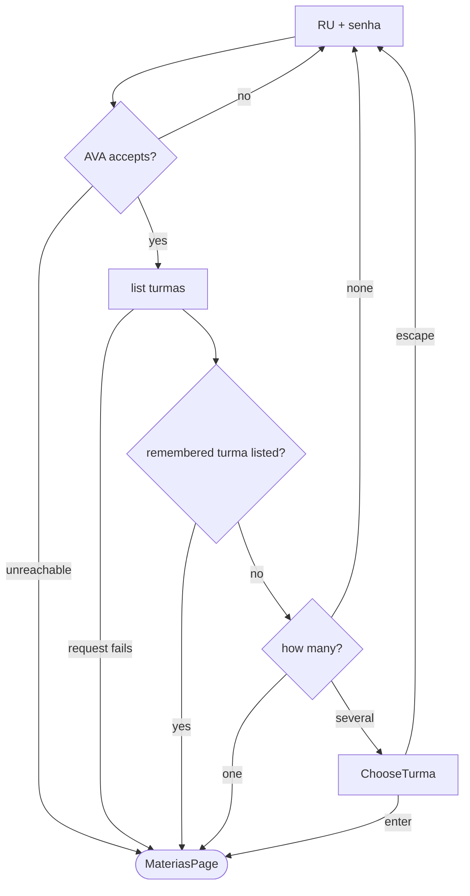

# The turma comes from the AVA

## TL;DR
- The login form asks RU and senha only; the CursoId field and its `?` help are gone.
- Once the AVA accepts them, the page lists the student's turmas and takes the curso id from there: the remembered one if the AVA still lists it, else the only one, else the student picks.
- `UNINTER_COURSE_ID` leaves `Settings` and `.env.example`; RU and senha in `.env` are enough to skip the form.
- A matérias sync that has no turma says why instead of killing its worker.

[0024](0024-login-page.md) put the CursoId on the form because nothing discovered it, so the student had to dig it out of DevTools. The call in `uninter-endpoints/turmas/` lists it, so the app asks the AVA instead of the student.

## Observed behaviour
- The login response carries `usuario.nome`, `RU`, `idUsuario` and `time`, and nothing about the curso. Proof: `uninter-endpoints/login.txt`, sent on 2026-10-22.
- `sistema/Curso/0/EscolaUsuario/true/?emCurso=true` answers `cursos`, one item per turma, with only the session cookie and `x-time`. Proof: `uninter-endpoints/turmas/list-turmas.txt`, sent the same day with the `.env` RU.
- That item's `idCurso` is 6079, the `UNINTER_COURSE_ID` of the same `.env`. `nome` is the curso (`BACHARELADO EM ENGENHARIA DE SOFTWARE - DISTÂNCIA`) and `turma` its label (`2025/02 GD ENGENHARIA DE SOFTWARE `, trailing space included).
- It also carries `idUsuarioCurso`, the value the matérias capture sends; `MateriaRequest` sends `0` and gets the list anyway.
- Inference: `emCurso=true` keeps only the cursos in progress, and no turma comes back as an empty `cursos` or as the AVA's 404. Only one turma has been seen.

## Decisions

### The turma is chosen at the login gate, behind the same wave
The page fetches the turmas right after `log_in` and before dismissing, so a rejected senha and a missing turma both land on the form.

### A remembered turma wins, then the only one, then the student's choice
The `course_id` in the holder counts only if the AVA still lists it, so a stale one never survives a login. One turma is taken without a question; several open `ChooseTurma`, a modal list of curso and turma; none refuses on the form.

### The row keeps `course_id`, now as the remembered turma
No schema change: what used to be typed is now what was chosen, so a student with several turmas picks once when "Lembrar de mim" is on.

### `.env` loses `UNINTER_COURSE_ID`
RU and senha are all the gate needs to run unattended. An old `.env` that still has the line keeps working, because `Settings` ignores unknown keys.

### A failed turmas request is an unreachable AVA
Any `httpx.HTTPError` there lets the student in without remembering anything, as `AvaUnreachable` already does at login: lookup does not depend on the AVA.

### Without a turma, the matérias sync says so
That only happens when the gate never reached the AVA and nothing was remembered. `_run_materias_sync` catches `NotLoggedIn` and tells the student to reopen the app once the AVA answers.

### `Turma` is a value, not a table
A frozen dataclass in `api/turmas/entity.py` with `curso_id`, `curso` and `nome`, built by `TurmaRequest` in `crawler/turmas/`. Nothing reads the turmas after the gate, so nothing stores them.

## Rejected
- **Keeping `UNINTER_COURSE_ID` as an override.** It is the DevTools hunt this spec removes, and a `.env` without it reaches the same turma through the AVA.
- **Taking the first of several turmas.** It would show another curso's matérias without a word.
- **A table of turmas.** Nothing reads them after the gate; the row's `course_id` is all that is worth keeping.
- **Resolving the turma inside `MateriaRequest` when the holder has none.** It duplicates the gate's choice for one path, offline at startup and online later, that reopening the app already fixes.
- **A palette command to switch turma.** Logging out already asks again, and only one turma has been seen.
- **Sending `idUsuarioCurso` in the matérias request.** The AVA answers without it.

## What execution corrected
- **The failed turmas request becomes `AvaUnreachable` inside `TurmaRequest`.** The page only knows the crawler's exceptions, so the translation of any `httpx.HTTPError` lives next to the request, and the page keeps one branch for a dark AVA.
- **Only a rejected senha clears the field.** No turma, or escape on `ChooseTurma`, brings the form back with RU and senha kept, since nothing about them was wrong.
- **`Credenciais.fill` takes RU and senha and leaves `course_id` alone.** A remembered turma survives retyping the senha after a rejection; the gate still checks it against the AVA's list.
- **`.env` still skips the row.** With RU and senha in `.env`, `stored()` never reads `credencial`, so a student with several turmas is asked at every startup. Nobody has more than one turma yet.
- `tests/cli/pages/login/test_login_turma.py` drives the gate against `httpx.MockTransport`: the only turma enters and is remembered, several ask, escape returns to the form, a remembered turma is not asked again and gives way when the AVA stops listing it, a failed listing still opens the app without remembering, and no turma holds the form for both an empty `cursos` and a 404, since which one the AVA sends is still inference. `tests/cli/pages/turmas/test_choose_turma.py` covers the modal. The response captured on 2026-10-22 parses to curso 6079 with the trailing space trimmed, and the modal renders under the app's stylesheets.
