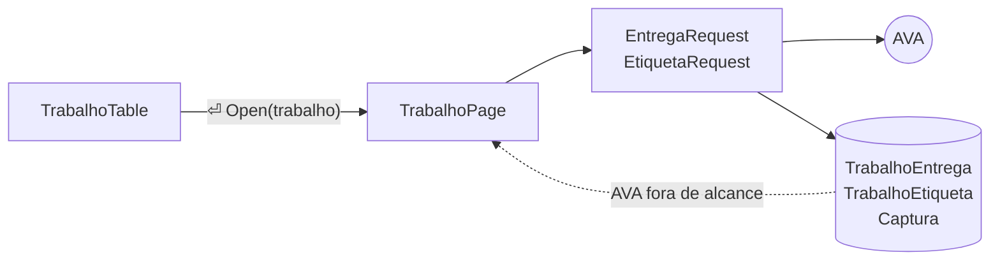

# The trabalho page

## TL;DR
- `⏎` on a row of the trabalhos tab pushes `TrabalhoPage`, the way an atividade opens the prova.
- The page asks `GetByEtapaUsuario` on every open and `GetByCorrecao` per corrected entrega; the stored rows answer when the AVA is out of reach.
- The matéria sweep stops fetching both, so a full sync drops the 24 requests it spends on pages nobody opened.
- Both responses become `Captura` rows: today they are parsed and thrown away, and no screen can be checked against what the AVA sent.
- The fake AVA grows an entrega with a correção, because today every mocked trabalho opens on the empty state.

Entregas and etiquetas have been written to the database since [0005](../done/0005-trabalhos.md), and nothing has ever read them back: `list_entregas` and `list_etiquetas` have no caller in `cli/`. The tab from [0011.1](../done/0011.1-trabalhos-tab.md) shows five columns off `Trabalho` alone, so the corretor's feedback on a delivered trabalho sits in the database and has never been on screen. What the project is: [CONTEXT.md](../../CONTEXT.md).

## Observed behaviour
Measured against `uninter.db` and the capturas stored in it today.
- 24 trabalhos, 8 entregas and 8 etiquetas, every one of them `tentativa: 1`, `Finalizado`, carrying a `correcao_id` and `anexos_correcao: 0`: nothing stored exercises a second entrega or a correction anexo, and 16 of the 24 trabalhos have no entrega at all.
- Every etiqueta has the same `constante`, `FORM_CORRECAO_COMENTARIO`. Inference: it reads like one member of an enum, and one student's corrected trabalhos are not the population.
- The feedback runs from 104 to 2789 characters, with ` ` and entities.
- `GET /interacao/TrabalhoEntrega/{id}/GetByEtapaUsuario/{vinculado_etapa}?master=true` and `GET /interacao/TrabalhoCorrecaoEtiqueta/{correcao_id}/GetByCorrecao` are the captured URLs, and the crawler builds both correctly — verified against trabalho 380543 of matéria 63085 and its correção 6576907.
- No response body for either has ever been stored, and neither capture file carries one. What `EntregaDTO` and `EtiquetaDTO` drop is unmeasured, and so is the claim that an anexo comes without a URL.
- The one trabalho response that is stored — the etapas list — sends 31 fields per etapa where `TrabalhoEtapaDTO` keeps 13. `idTrabalho` (340190) is not the etapa `id` (380543), and `tentativa` and `exibirTentativa` are among the dropped.
- `TrabalhoSyncService.sync` is the only caller of either endpoint: one `GetByEtapaUsuario` per trabalho and one `GetByCorrecao` per correção, serially, on a whole-matéria sweep, and nothing refetches afterwards.
- `_store` captures only the etapas response, and `lookup.KEYS` maps `trabalhos` to `trabalhoEtapas` alone. `RequestLog` sees both requests, but in memory, capped at 50 and lost on restart.
- The fake AVA answers both routes with empty collections, so "Trabalho aprovado (Mockado)" paints a delivered, graded trabalho whose body reads "Nada foi entregue neste trabalho."
- `DataTable` binds `enter` to `select_cursor` with `show=False`, and nothing in `cli/` handles `RowSelected` today.

## Decisions

### The AVA is asked on every open, and the database answers when it will not
A trabalho em correção becomes corrigido without warning, so what is on screen should be what the AVA says now — the same rule [0030](./0030-gabarito-of-a-prova.md) sets for the gabarito. The page is pushed first and loads inside itself, `AvaUnreachable` falls back to the stored rows, and only a cold open with nothing stored ends in a toast. This is what takes the spec out of `[frontend]`: the fetch belongs to a service, and the page gets it injected.

### The sweep stops fetching what only the page reads
`_fetch_details` costs one request per trabalho plus one per correção on every matéria sync, for data no screen read until now. With the page fetching on open, keeping it too would pay twice for the same rows and keep the sweep growing with the trabalho count. The sync goes back to the etapas list alone.

### Both responses are stored as capturas
The entrega and etiqueta payloads are parsed and discarded, which is why the claims above are inference and why the debug panel has nothing to show on this page. Each becomes a `Captura` keyed by trabalho, with `lookup.KEYS` learning `trabalhoEntregas` and `trabalhoCorrecaoEtiquetas`, so the panel answers on `TrabalhoPage` the way it does on every other screen.

### `⏎` reaches the page as an `Open` message
`TrabalhoTable` listens to Textual's `RowSelected` and re-posts `Open(trabalho)`, the way `AtividadeTree` re-posts `Start`, so the page never handles a `DataTable` event. The key is Textual's and fires whether or not we mention it, so the subclass re-declares it with a description in Portuguese, and `check_action` hides it while the table has no rows.

### The header drops what the trabalho does not have
`DetailHeader.show` joins its parts without filtering, so a trabalho with no entrega and no nota paints `prazo 28/08/26 ·  · `. The page filters before handing the list over.

### The feedback renders through `html_to_blocks`, and a table block is flattened
The etiqueta HTML is the shape [0026](../done/0026-html-to-textual.md) already handles for a questão, and a second caller is what that renderer was waiting for. It returns `Prose | Table`; rendering a real table would mean promoting `QuestaoTable` to `cli/components/`, so the page joins a table block's cells into lines until a stored etiqueta contains one.

### An anexo is a number the page prints and cannot open
`2 anexos` says the entrega carried files, which is worth knowing even when nothing opens them. The `ANEXOS` endpoint has never been captured, and this repo does not guess endpoints. Only the entrega line carries a count while `anexos_correcao` is 0 everywhere.

### A trabalho with no entrega gets the empty state
16 of the 24 open on nothing. The message goes through `Hint.show_or`, like every other one ([0016.8](../done/0016.8-empty-state.md)), instead of a page that paints an empty box.

### The fake AVA serves one corrected entrega
[0028](../done/0028-fake-ava.md) exists so the interface can be driven without the real AVA, and this is the first page it cannot show. The mocked trabalho that carries `dataEntrega` and a nota gains an entrega with a `correcao_id` and an etiqueta whose text has the ` ` and the entities the real ones have — otherwise dev mode agrees with nothing this page does.

## Rejected
- **A detail pane under the table.** The longest feedback stored today is 2789 characters, and the pane would be a scrollbox inside a tab.
- **Keeping the eager fetch as a warm cache.** It would make every sync pay for pages nobody opens, to save a round trip the page already survives without.
- **Downloading the anexos.** No capture exists, and guessing the URL means hitting the university's server until something sticks.
- **The gabarito.** Nothing is captured for it either; it waits in [0030](./0030-gabarito-of-a-prova.md).
- **Turning the etiqueta HTML into text in the crawler.** The layer that talks to the AVA stores what the AVA sent.
- **Showing the etiqueta `constante`.** It is the same value on all 8 rows, so it labels nothing until a second one appears.
- **Trusting `RequestLog` instead of storing the capturas.** It holds the current session only, so the evidence goes away exactly when someone reopens the app to look for it.
