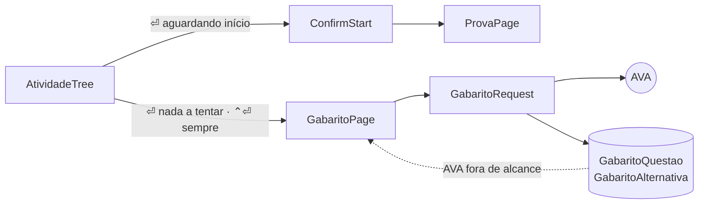

# The gabarito of a prova

## TL;DR
- `enter` on a finalizada opens `pages/gabarito/`; what keeps the gabarito request off an unstarted prova is the stored `avaliacao_usuario_id`, which the AVA only numbers once an attempt exists.
- `AtividadeDTO` stops discarding the `AvaliacaoUsuario` id, which `MockedProvas` stands in for with the avaliação's — a URL that resolves only because the fixture gives the mocked atividade one number for both.
- `GabaritoRequest` asks the AVA on every open; `GabaritoQuestao` and `GabaritoAlternativa` keep each tentativa so a gabarito seen once survives the AVA being down.
- A questão shows its alternativas marked — `✓` correct, `✗` the wrong pick — with the comentário below, and the resumo closes the list with every miss and its gabarito.
- `AlternativaDTO` reads its atributos by `nomeAtributo`; by position it returns the string `true` against the real AVA.

The sketch is [view-gabarito-prova](../view-gabarito-prova.sketch.md): checking a prova finalizada and understanding where the points went. Enter on a finalizada does nothing today, and the app has never read a finished prova. Context in [CONTEXT.md](../../CONTEXT.md); the prova flow in [0015](../done/0015-atividade-completion.md), the pages in [0018](../done/0018-pages-and-their-components.md).

## Observed behaviour
Measured over thirteen live responses, sent against the account in `.env`.
- `GET /bqs/AvaliacaoUsuarioHistorico/{avaliacaoUsuarioId}/Avaliacao?autorizacao=` answered 200 for all eleven finalizadas tried — every `idAvaliacaoTipoGabarito` in the database (1, 2, 4, 5 and 6), presencial and remote alike.
- `permiteVisualizarGabarito` and `permiteVisualizarErros` are `false` on all 59 finalizadas stored and `mensagemGabarito` is null, yet the endpoint answers in full. The flags gate the AVA's own button, not the data.
- Exactly one alternativa per questão carries the atributo `correta: "true"`, and the atributo `comentário` sits on that same one — on every questão of every payload read. It names the source: "A resposta correta é a letra A, conforme item 1.3 do Tema 1 da AULA 3".
- `idQuestaoAlternativa` is the alternativa chosen and `percentualAcerto` is 100 or 0. On a prova with nota 40 the correct alternativa is given for all eight misses, so the payload answers more than the grade does.
- The endpoint serves the current tentativa only: three second-attempt provas returned ten rows each, all `tentativa: 2`. The `AvaliacaoUsuario` id is the same one the listing carries, so a retry moves the counter and not the id — and the previous tentativa is then unreachable anywhere.
- `atributos[0]` is `correta` as often as it is `texto`, so `AlternativaDTO.to_alternativa` reading `atributos[0].valor` yields `"true"`. It survives only because the fixture hands it a one-element list of plain strings, where the AVA sends HTML.
- `iniciar-atividade.txt` captures the same URL — one endpoint serves the questões of an attempt and its correction — so asking for it on an atividade that has not started is what starts it and spends a tentativa, as [0015](../done/0015-atividade-completion.md) already warned.
- The fixture answers that route already, but its `questaoAlternativaAtributos` carry `valor` and no `nomeAtributo`, and it gives the mocked atividade one number for both its avaliação and its avaliacaoUsuario. Dev mode agrees today with exactly the two things this spec calls wrong.
- `MockedProvas.fetch` GETs that same URL with `atividade.id`, the avaliação's number, and refuses every atividade outside the mocked matéria, so the substitution has never reached the real AVA.
- `podeTentarNovamente` and `situacaoNovaTentativa` are null on all 151 rows, and `statusDataAvaliacao` takes -1, 0 and 1 on past and future prazos alike. None of them answers whether a retry is possible; `tentativa`, `tentativa_total` and `fim` do.

## Decisions

### The listing keeps the `AvaliacaoUsuario` id
`Atividade.id` is the avaliação's id, and the gabarito is keyed by the avaliacaoUsuario's — a second number in the same payload, discarded since [0001](../done/0001-ava-atividades-crawler.md). `avaliacao_usuario_id` becomes a column, filled by `to_atividade`, and the URL moves into the crawler, since the gabarito and `MockedProvas.fetch` are the same GET and should not spell it twice. `schema_is_behind` rebuilds the database from the AVA, so the column costs a resync and no migration.

### `enter` on a finalizada opens the gabarito
A finalizada has no other meaning for `enter`: starting a retry is not implemented, and `on_atividade_tree_start` returns on anything that is not `Aguardando início`. What keeps the two readings of one endpoint apart is not a tentativa count but `avaliacao_usuario_id`, which the AVA leaves at `0` until an attempt exists — so the request cannot reach a prova that has never been started, whatever the row's tentativas say. The presencial gate stays where it is: it refuses to *start* a prova, and twelve of the finalizadas are presencial Provas Objetivas whose gabarito is exactly what is worth reading.

### The gabarito is a page, not a mode of the prova
`ProvaPage` exists to answer: picking, saving, the clock counting up, the warning that nothing was sent. A gabarito never answers, and its alternativas are HTML to read rather than options to choose, so sharing the screen would branch eight of its methods and ask one widget to be an `OptionList` in one mode and prose in the other. `pages/gabarito/` gets its own page; `QuestaoList` moves up to `cli/components/` on its second caller, as [0018](../done/0018-pages-and-their-components.md) prescribes. The page ships with its tests.

### The AVA is asked on every open, and the database answers when it will not
A gabarito is fetched each time the page opens, so what is on screen is what the AVA says now. The stored rows are the fallback: `AvaUnreachable` falls back to them, and only a cold open with nothing stored ends in a toast. The page is pushed first and loads inside itself, with the `Loading` wave in the detail pane, because every open now costs a round trip. Fetching per matéria instead would add some 59 requests to a full sync for pages nobody opened.

### A tentativa is never overwritten
`tentativa` is part of the primary key of both tables, so the gabarito of attempt 1 survives attempt 2. The AVA cannot contradict what is kept — it no longer has it — and a retry rewrites the questões, since these avaliações carry `reutilizarQuestoesErradas: true`. The page reads the highest tentativa and offers no way to the older ones; keeping them costs a column, showing them would cost a second axis of navigation.

### The verdict is a mark, and the comentário is always shown
A questão is `✓` when correct and `✗` otherwise — leaving a questão blank scores the same zero as answering it wrong, so the row says so. An alternativa is `✓` when correct, `✗` when it is the wrong one chosen, dim otherwise, and the comentário renders through `html_to_blocks` under the list on every questão — not only the missed ones, because the citation is worth reading on a lucky guess. The resumo position that closes the question list becomes the overview the sketch asks for: one line per questão, the letter chosen and, where they differ, the gabarito's.

### `AlternativaDTO` looks its atributos up by name
`nomeAtributo` selects `texto`, `correta` and `comentário`; position selects whatever the AVA ordered that day. The fix lands on the shared DTO because it is wrong for the prova too, and the gabarito's extra fields extend it rather than parse the payload a second time. The fixture has to name its atributos in the same change, give the mocked finalizada an avaliacaoUsuario id of its own and serve `correta` and `comentário` on it — otherwise dev mode keeps agreeing with the bug.

## Rejected
- **The detalhes request (`AvaliacaoUsuario/0/UsuariocId/{oferta}?cIdAvaliacao=`).** Sent and answered, but it returns a listing row we already store; with `avaliacao_usuario_id` persisted nothing needs the round trip.
- **Respecting `permiteVisualizarGabarito`.** It is false on every finalizada this student has, including the ones the AVA served in full. Honouring it would hide all 60 gabaritos and the feature with them.
- **A `revisao` flag on `ProvaPage`.** One page with two meanings, branching in `show`, `fill_alternativas`, `state`, `tick`, `debug_view` and three handlers.
- **A `gabarito()` on `ProvaSource`.** Its only implementation refuses every atividade outside the mocked matéria, so the gabarito would be reachable in dev mode and nowhere else.
- **Caching the gabarito instead of re-fetching.** A closed tentativa never changes, so it would be sound — and it would show a stored copy of a prova whose nota moved without telling anyone.
- **Fixing `ProvaPage`'s alternativa rendering here.** Real alternativas are HTML and its `OptionList` escapes Rich markup, not tags; making that widget host blocks is a redesign of the answering screen, which cannot reach a real alternativa while `MockedProvas` is its only source. It is a gap the prova spec inherits.
- **A `Gabarito` header row above the two tables.** It would hold `nota`, already on `Atividade`, and counts that are one `sum()` away.
- **Storing the response as JSON in one column.** Smallest schema, and it stops the mirror being queryable — a gabarito would be text, not facts.

## What execution corrected
- **The `AvaliacaoUsuario` id is 0 until a prova is started.** Across every listing stored before this change, all 63 finalizadas carried a non-zero `id` and 89 of the 96 `Aguardando início` carried `0` — the AVA has no row for an attempt nobody has made. The spec says only that the listing carries the id. `avaliacao_usuario_id` defaults to `NOT_STARTED = 0` and `Atividade.tem_gabarito` is `finalizada and avaliacao_usuario_id != 0`, so the gate is a stored fact rather than a coincidence of the finalizada gate.
- **The fixture half of the last decision arrived before execution did.** Against `3ef58c7` the spec is exact: `atividades()` emits `"id": -(position + 1)` for both numbers and every atributo is a bare `{"valor": ...}`. The working tree already carries the fix — named atributos, `_usuario_id` beside `_avaliacao_id`, `gabarito()` with `CORRECOES` — staged and uncommitted, alongside other work that is not this spec's. So this change is the DTO alone, and the fixture it needs is only true of the tree, not of `main`. That also inverts the bullet's conclusion in the tree: dev mode no longer agrees with the bug, it is what exposes it, because the fixture sends `[correta, texto, comentário]` and `atributos[0].valor` reads back `"true"`. Dormant only while `enter` on a finalizada does nothing.
- **The AVA sends an absent field as an explicit null, and a pydantic default never fills one.** Opening a real gabarito crashed the `load` worker with ten validation errors: `comando` is `null` on every questão of a real APOL. Nothing caught it because the fixture — the only payload any test or dev-mode run has ever seen — always sends a comando. `questao`, `comando`, `tentativa`, `percentualAcerto` and an atributo's `nome`/`valor` now carry `AvaText`/`AvaCount`, which coerce null at the boundary, and five page tests drive a real payload shape with nulls through `QuestoesDTO` into the page.
- **A payload the DTO cannot read is a toast, not a crash.** `GabaritoService.open` caught `AvaUnreachable` and `httpx.HTTPError` but not `ValidationError`, so a shape surprise killed the worker and painted a traceback over the app. It now falls back to the stored tentativa like any other failed fetch, which is what [0015](../done/0015-atividade-completion.md)'s `start_prova` already does with `(OSError, ValidationError)`.
- **The fake AVA now leaves questões unanswered.** Every mocked gabarito answered every questão, so dev mode could not show the case a real APOL is full of, and it never sent `idQuestaoAlternativa: null` either. `Avaliacao` gained `em_branco` beside `erros`: `APOL Objetiva 3` mixes three wrong answers with two blanks for 5/10, and `Prova Objetiva (Segunda Chamada)` is the abandoned prova — one answered, nine blank, nota 10 — which is the shape that found both this bug and the null above. `_acertos` counts through `_acertou` rather than subtracting two lengths, so an ordem listed in both never scores twice.
- **An unanswered questão is a miss, not a blank.** The first pass gave it a neutral dim `○` and dim `sem resposta`, which read as *nothing happened* on a real APOL where nine of ten questões were never answered — while the nota said 10 and the resumo said `1/10`. It scores what a wrong answer scores, so it now carries the same `✗` and the same colour; only the words differ, because `sem resposta` says more than `incorreta`. The alternativa list still marks nothing as chosen, since nothing was.
- **A theme variable cannot cross into a `rich.table.Table`.** [0025](../done/0025-global-colours.md) already recorded it, and the first draft of the sidebar row hit the same `MarkupError` that crashed the prova screen. The gabarito components carry a `Palette` of two tokens — `ANSI` for the rows an `OptionList` renders through rich, `THEME` for the markup a `Static` resolves — instead of one set of colours that is wrong on one side.
- **`QuestaoTable` moved up with `QuestaoList`.** The spec promotes only the list, but the gabarito renders the same enunciados, and a real APOL questão carries `<table>`. It is on its second calling page, so [0018](../done/0018-pages-and-their-components.md) applies to it too; it lives in `cli/components/table.py`. `preview` moved with them for the same reason.
- **The gabarito letter belongs to the resumo alone.** Putting it on the sidebar row as well truncated at the `Sidebar`'s 44 columns (`d) select, create… · gaba…`), which is the spec's own decision read too widely: the resumo is where the misses and their gabarito are listed.
- **`anulada` is parsed and dropped.** The payload carries it and nothing on screen reads it, so storing it would repeat what [0029](0029-trabalho-page.md) found — entregas and etiquetas written since [0005](../done/0005-trabalhos.md) that nothing ever read back.
- **The page takes a `GabaritoSource` Protocol**, the way `ProvaPage` takes `ProvaSource`, so the test's fake is type-checked against the real interface instead of subclassing the service.
- **The two-key split made `enter` dead on the rows the feature is for.** The spec justified it with "`enter` keeps starting the prova", which is not true of any finalizada: `on_atividade_tree_start` returns on anything that is not `Aguardando início`, so starting a retry has never been implemented. Pressing `enter` on `APOL Objetiva 3` — finalizada, tentativa 1/3, prazo ahead — did nothing at all. `enter` now opens the gabarito of any finalizada and `ctrl+enter` is gone, which also retires the kitty-protocol risk the spec flagged. The safety it was protecting is stronger without it: `tem_gabarito` requires a stored `avaliacao_usuario_id`, and the AVA numbers one only once an attempt exists, so the request can never reach a prova that would be started by it.
- **`enter` cannot be announced on a `Tree`.** Measured on Textual 8.2.8: `check_action` returning `True` shows the key and lets it through, but both `False` and `None` stop `enter` collapsing a group row. There is no "fires but stays out of the footer", so the key keeps `Tree`'s own `show=False` binding, exactly as starting a prova always has. [0029](0029-trabalho-page.md) could guard it on a `DataTable` only because a table has no group rows to break.
- **No debug panel on the page.** `ProvaPage` has one and the gabarito response is never stored as a `Captura`, so there would be nothing to show. Left out rather than half-wired.
- Verified headless against the fake AVA and a rebuilt database: `APOL Objetiva 2 (Mockada)` opens on tentativa 2 with `8/10`, paints `✓ c) SQL Server, MySQL, PostgreSQL e Oracle` against the dimmed alternativas, carries the corretor's citation under them, and the round trip through `GabaritoRepository` returns the same rows with the comentário intact. The listing's `avaliacao_usuario_id` (`-102`) is the number the URL used, not the avaliação's (`-2`).
