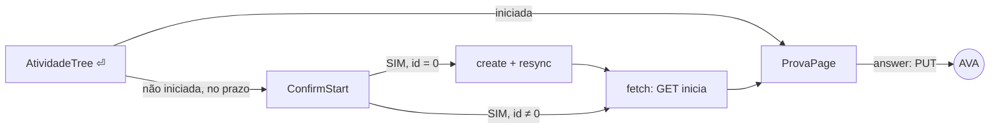

# The real prova source

## TL;DR
- `AvaProvas` is the only `ProvaSource`. It has three requests: `create` (the tentativa GET, sent on SIM), `fetch` (the GET that starts the attempt and loads the questões) and `answer` (the PUT). `MockedProvas` is deleted; dev mode reaches the same code through `FakeAva`.
- `ConfirmStart` shows while the attempt is not started. SIM creates the attempt if it has no id yet, then starts it. An attempt that is already started opens directly. An unstarted atividade whose prazo has passed does nothing.
- The listing keeps `cIdAvaliacao`, `cIdAvaliacaoVinculada` and `horarioInicio`, and the new attempt's id is read back by re-syncing the matéria.
- An answer is marked on screen only after the PUT succeeds.
- The fixture stops answering real saves: today every PUT to the answer URL is swallowed by `FakeAva`.

Since [0015](../done/0015-atividade-completion.md) the prova flow has only ever run against the mock, and `MockedProvas` refuses every atividade outside the mocked matéria. After this spec, any remote prova within its prazo can be started and answered from the terminal. Handing it in stays in the browser. Context in [CONTEXT.md](../../CONTEXT.md); the gabarito's use of the same GET in [0030](../done/0030-gabarito-of-a-prova.md).

## Observed behaviour
Measured on 2026-09-29 against the account in `.env`.
- `criar-tentativa.txt` is `GET AvaliacaoUsuario/0/tentativa/{n}?ap=false&idAvaliacaoVinculada={cIdAvaliacaoVinculada}&cIdAvaliacao={cIdAvaliacao}&cache={ms}`. The browser sends it on "Sim" in the modal of orientações para realização da avaliação. It was captured by the student, not sent by the app.
- It creates the attempt without starting it. SGBD's APOL Objetiva 2 went from `id: 0` to 155658496, with `dataCriacao` equal to the curl's `cache` timestamp (13:22:43) and `horarioInicio` still null; POO's went to 155658435 the same way. Its response body was not measured.
- Both cIds sit on every real listing row (151). The 8 mocked rows carry neither.
- The three older attempts were created between 8 minutes and 2 days before `horarioInicio` was set, and `horarioInicio` matches the questões' `dataCriacao` to the second. That the GET is what sets it is inferred from the one capture sent at that second.
- The GET answered 200 on those three attempts and `QuestoesDTO` parsed all three. The AVA returns answers already given in `idQuestaoAlternativa`.
- Replaying the captured PUT with the answer questão 1 already had answered 200 with `exception: null, mensagens: []`, and the answer read back unchanged. What a refused save looks like is unmeasured.
- `status` stays `Aguardando início` on a created or started attempt.
- `get-tempo-decorrido` only does arithmetic on the values it is sent (`dataFinal` = `dataCriacao` + `n` minutes, measured twice).
- `fixture.payload` answers any PUT to `/bqs/AvaliacaoUsuarioHistorico/` with `ANSWERED`, and `main.py` always installs `FakeAva`, so a real save would never leave the machine. Read in the source.

## Decisions

### `AvaProvas` replaces `MockedProvas` instead of sitting beside it
`FakeAva` already mocks at the transport, so the real source running over it is dev mode. A second implementation of the same requests would only drift. `AvaProvas` lives in `crawler/atividades/prova.py` next to `AVALIACAO_URL`, and `api/mock/provas.py` goes.

### The gate follows the attempt's own state
`iniciada_em` set: the prova opens directly, because the GET only reads an attempt that is already running. `iniciada_em` null and prazo ahead: `ConfirmStart`, whose SIM stands for the AVA's "Sim" and spends the tentativa. `iniciada_em` null and `fim` past: `enter` does nothing. Presencial keeps its toast.

### SIM creates, re-syncs, then starts
With `id: 0`, SIM sends `create` for `atividade.tentativa`, then re-syncs the matéria through `AtividadeSyncService`, then sends the GET. The id is read from the listing, where it was measured, rather than from a create response nobody has seen. With an id already set, SIM goes straight to the GET, which is the case both APOL Objetiva 2 are in now. The matéria is synced again when the page closes, so the tree picks up `horarioInicio`.

### The listing keeps what the requests need
`AtividadeDTO` keeps `cIdAvaliacao`, `cIdAvaliacaoVinculada` and `horarioInicio` as the columns `avaliacao_cid`, `avaliacao_vinculada_cid` and `iniciada_em`. `iniciada_em` replaces `ProvaSource.started_at` as what feeds `Iniciada` and the clock, and the page's `started()` loop goes. The new columns cost a resync through `schema_is_behind`, as [0030](../done/0030-gabarito-of-a-prova.md)'s did.

### The AVA holds the answers, and a save comes before the mark
`fetch` seeds `Prova.respostas` from `idQuestaoAlternativa` on every open, and nothing is kept in memory between opens. `answer` raises on an HTTP error, on `AvaUnreachable` and on a non-null `exception`; that last condition is inferred. The page PUTs first and marks second. On failure it toasts `Resposta não salva no AVA` and leaves the questão as it was. Re-authenticating after a 401 stays in [the 401 bug](../bugs/401-crash-bugfix.bug.md).

### The page stops calling itself a mock
`MOCK_TAG` and `Nada foi enviado ao AVA.` go. The resumo reads `Respostas salvas no AVA. A prova não foi entregue.`, because submitting is not implemented.

### The fixture answers only its own requests
`FakeAva` passes the request body to the fixture, which answers the PUT only for a mocked `idAvaliacaoUsuario`, and answers `create` only for a mocked `cIdAvaliacao`. Mocked rows get cIds. Among the `Aguardando início` rows there is one with `id: 0`, one created but not started, and one started with a `horarioInicio`, so dev mode walks every branch of the gate.

### Tests ship with it
Page tests drive a real payload shape through `QuestoesDTO`. They cover seeded answers, a failed save that leaves the questão unmarked, and SIM on a row with `id: 0`, which must send `create`, sync, then GET, in that order. A fixture test proves that a real PUT and a real `create` are passed on to the real transport.

## Waiting on a capture
- **Submitting.** No capture exists, and it is unknown whether the AVA closes an open attempt at its prazo.

## Rejected
- **Reading the new id from `create`'s response.** It is unmeasured, and the listing already showed the id a minute later.
- **`get-tempo-decorrido` for the start instant.** It only does arithmetic on what it is sent, and the listing carries `horarioInicio`.
- **Routing by matéria between `MockedProvas` and the real source.** It is two copies of the same requests, when `FakeAva` already routes.
- **Marking the answer first and reverting on failure.** For the length of the round trip, the screen would claim a save that has not happened.
- **Storing answers in `uninter.db`.** The AVA holds them, and the GET reads them back.
- **A countdown from `tempoTotalAvaliacao`.** It is 0 on every prova within its prazo today.

## What execution corrected
- **The create step reads the listing, it does not sync it.** `AtividadeSyncService.sync` writes through the session the background queue shares, and a queued sync of another matéria can be running at that moment. `ProvaService` reads the id through `AtividadeRequest`, and `open_prova` then enqueues the matéria's atividades, whether the prova opened or failed. That enqueued sync is what stores the id and `horarioInicio`, and it keeps a failed start from asking to create the attempt twice.
- **The prova's clock comes from the questões, the tree's from the listing.** The listing read after `create` is taken before the GET, so it has no `horarioInicio` yet. `Prova.iniciada_em` is the earliest `dataCriacao` among the questões, which matched `horarioInicio` to the second on all three attempts measured. The tree keeps reading `Atividade.iniciada_em`.
- **`enter` decides in the tree.** `AtividadeTree` posts `Open` for a gabarito, `Resume` for an attempt that is running, `Start` for one within its prazo, and nothing once the prazo has passed. It judges the prazo with the same `now` it paints the deadline column with. The matérias page keeps only the presencial toast and `ConfirmStart`.
- **Every AVA failure is a `ProvaFailed`.** The old `start_prova` caught `(OSError, ValidationError)`, and an httpx error is neither, so a 401 on start would have killed the worker. `failing_as_prova` wraps `httpx.HTTPError`, `AvaUnreachable`, `LoginRejected` and `ValueError`. `fetch` also refuses `id: 0` before sending anything, since `…/0/Avaliacao` would go to the AVA.
- **No fixture test.** `novo-teste` tests only `cli/`, so `api/` and `crawler/` get none. The create → listing → GET order and the fixture's routing were checked headless against `MockedAva`, with a recording transport standing in for the AVA. Prova Discursiva (`id: 0`) sent the three requests in that order and came back as `-107` with `iniciada_em` set. An answer saved and then read back seeded `respostas`. APOL Objetiva 4 (created, not started) sent the GET alone. A PUT and a create carrying the real ids of SGBD's APOL Objetiva 2 both went past the fixture to the outer transport.
- **The fixture is a stateful `MockedAva`.** It creates, starts and records answers only for its own ids and cIds. `APOL Objetiva 1 (Mockada)` has been running for 25 minutes, `Prova Discursiva (Mockada)` has `id: 0`, and the new `APOL Objetiva 4 (Mockada)` is created but not started.
- **Two old prova tests could not fail.** They asserted `respondida` against the whole header line, and `não respondida` contains it. They now read the header part by part, as the new tests do.
- **The debug panel shows the real response.** It used to label its source `mock`; `raw` now returns the `AvaResponse`, and the panel shows its URL and status.
- `pdm run test` passes, 324 tests. `uvx pyright` is clean. `ruff format` is clean; `ruff check` reports only the rules the codebase already breaks everywhere (naive `datetime.now()`, import order).
