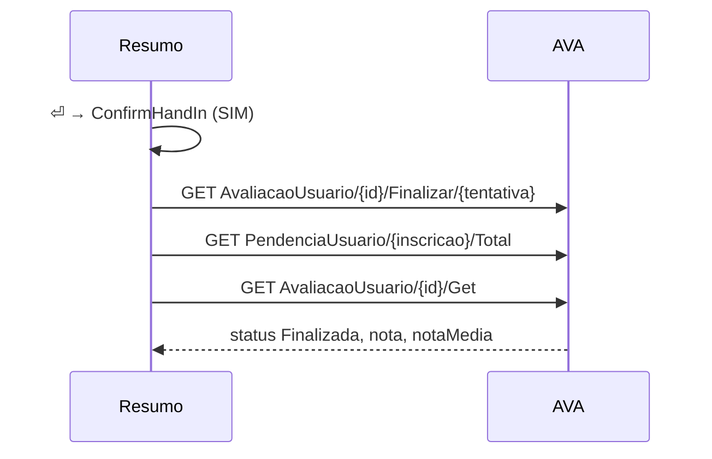

# Handing in a prova

## TL;DR
- `enter` on the resumo asks `ConfirmHandIn`: SIM hands the prova in, NÃO leaves it open.
- Handing in sends `Finalizar`, then `PendenciaUsuario/{inscricao}/Total`, then `AvaliacaoUsuario/{id}/Get`, the same three requests in the same order as the browser.
- The resumo then shows the nota and the contribuição from `Get`, and the page stops taking answers.
- `Materia` keeps `idUsuarioSalaVirtualOferta` as `inscricao_id`, which the pendências request needs.
- The fixture hands in its own attempts, grading them against `CORRECOES`.

[0032](../done/0032-real-prova-source.md) left handing in to the browser, so a prova answered in the terminal still has to be opened in the AVA to finish. With this spec the student hands it in from the resumo and sees the nota without leaving the screen. Context in [CONTEXT.md](../../CONTEXT.md).

## Observed behaviour
The student captured `Finalizar` on 2026-10-06 while handing in SGBD's APOL Objetiva 1 (154653964). The app never sent it. The two GETs were sent afterwards against the account in `.env`.
- After `Finalizar`, `Get` returns `status: Finalizada`, `nota: 90`, `notaMedia: 13.5` and `horarioTermino: 2026-10-06T16:28:48`. `idAvaliacaoUsuarioStatus` went from 4 to 3 and `idAvaliacaoUsuarioEntrega` from 0 to 1; POO's unsubmitted APOL Objetiva 1 still reads 4 and 0.
- `Get`'s `avaliacaoUsuario` parses unchanged through `AtividadeDTO.to_atividade`, because its nested `avaliacao` carries `nome`, `nomeAvaliacaoTipo` and `pesoMedia` like a listing row does.
- How long the AVA takes to fill `nota` after `Finalizar` was not measured: `Get` was sent once, after the fact.
- In `Finalizar/1`, both `tentativa` and the new `idAvaliacaoUsuarioEntrega` are 1, so which one the segment means is inferred, not measured.
- `PendenciaUsuario/93539554/Total` answered `totalAvaliacao: 2`. The same number, 93539554, is SGBD's `idUsuarioSalaVirtualOferta` in the matérias listing, where `pendenciaTotalAvaliacao` read 3 before the hand-in. `MateriaDTO` drops the field today.
- After the hand-in, with tentativas and prazo left, `AvaliacaoUsuarioHistorico/{id}/Avaliacao` sends each questão's `percentualAcerto` (nine 100s and one 0, which matches the 90) but no `correta` and no comentário. `mensagemGabarito` says the full gabarito waits for the prazo or the last tentativa. That is unlike the 11 finalizadas [0030](../done/0030-gabarito-of-a-prova.md) read.

## Decisions

### The resumo is where a prova is handed in
`enter` on the resumo row does nothing today, and the resumo is already the screen that lists every answer, so it is the natural last stop. `ConfirmHandIn` is a `Confirm` that says how many questões are still unanswered and that the answers cannot change afterwards. An unanswered questão is allowed, because the AVA scores it as a miss, as [0030](../done/0030-gabarito-of-a-prova.md) found.

### The three requests go in the browser's order, and only `Finalizar` can fail the hand-in
`ProvaService.hand_in` sends `Finalizar` for `atividade.tentativa`, then the pendências request, then `Get`.
- If `Finalizar` fails, it raises `ProvaFailed`: the page toasts and keeps taking answers.
- The pendências response is unused, as it is in the browser, and a failure there is ignored.
- If `Get` fails, the hand-in still counts. The resumo says the prova was handed in without a nota, and the matéria sync that [0032](../done/0032-real-prova-source.md) enqueues on close brings the nota in.

### The page shows the result, and the tree learns it from the sync
After the hand-in the hint reads `Prova entregue · nota 90 · contribuição 13,5`. The letter keys and the alternativas stop answering, because a PUT on a finished attempt has no meaning. The row in `uninter.db` is not written from `Get`: the background queue shares the session, which is why [0032](../done/0032-real-prova-source.md) reads rather than writes during the start, and its sync on close lands within seconds.

### `Materia` keeps the inscrição
`inscricao_id` is a column filled from `idUsuarioSalaVirtualOferta`, and it costs a resync through `schema_is_behind`. A matéria without one skips the pendências request instead of guessing.

### The fixture hands in its own attempts
`MockedAva` answers `Finalizar` only for a mocked id. It grades the recorded answers against `CORRECOES` and moves the attempt to `Finalizada`, so `Get`, the listing and the gabarito all agree afterwards. It answers the pendências request for the mocked matéria's `inscricao_id`. A real id passes through to the AVA, as in [0032](../done/0032-real-prova-source.md).

### Tests ship with it
Page tests cover:
- `enter` on the resumo opens the confirmation, and NÃO keeps the prova open;
- SIM shows the nota and stops answering;
- a refused `Finalizar` leaves every letter key working.

## Rejected
- **A key of its own, from any questão.** Handing in is final; reaching it only from the screen that lists every answer is the confirmation before the confirmation.
- **Writing the `Get` row into `uninter.db`.** The background queue shares the session, and the sync on close already stores the same row.
- **Skipping the pendências request.** The student asked for the browser's sequence, and it costs one GET.
- **Showing per-questão verdicts on the resumo.** The gabarito page already shows them from `percentualAcerto`, and `enter` on the finalizada row opens it.
- **Refusing to hand in with questões unanswered.** The AVA accepts it, and the confirmation already gives the count.

## What execution corrected
- **The hand-in waits for the saves still in flight.** While this spec ran, another change made answers mark at once and save in the background after a short delay, with retries. That reverses the save-before-mark rule of [0032](../done/0032-real-prova-source.md). Handing in right after the last answer could therefore send `Finalizar` before that answer's PUT. `confirm_hand_in` now waits for every pending answer worker before it opens the confirmation, so the count it shows is what the AVA holds. A test holds a save open and checks that the confirmation only appears after it lands.
- **`ProvaPage` takes the `Materia`, not its name.** The pendências request needs `inscricao_id`, and the page is the one that hands in.
- **`ConfirmHandIn` lives in `cli/pages/entrega/`,** beside `ConfirmStart` in `inicio/`. It keeps `Confirm`'s default focus on NÃO, because handing in is final.
- **The resumo was titled `prova finalizada` before anything was handed in.** It now reads `resumo`, turns into `prova entregue` after the hand-in, and its warning ends with `⏎ para entregar`, so the key can be found from the screen.
- **The result keeps the row's place.** `Get` carries no position, so `to_atividade` takes the `materia_id` and `posicao` of the atividade being handed in.
- **The fixture's gabarito shows the answers actually given.** For the provas it seeds, a wrong pick was always the alternativa after the correct one. A handed-in mocked attempt is now graded and rendered from the recorded answers.
- Verified offline against `MockedAva`, with a recording transport standing in for the AVA. `APOL Objetiva 1 (Mockada)`, with 7 right, 1 wrong and 2 blank, sent `Finalizar/1`, `PendenciaUsuario/-1/Total` and `Get` in that order. It came back `Finalizada` with nota 70 and contribuição 7, and the next listing reads the same with `tem_gabarito`. A real attempt id and inscrição sent all three requests past the fixture.
- Tests: seven on the prova page (the confirmation, NÃO, the nota, no answers afterwards, a hand-in without a result, a refused `Finalizar`, and the wait for saves) and three on `ConfirmHandIn`. `pdm run test` passes, 340 tests; `uvx pyright` and `ruff format` are clean.

