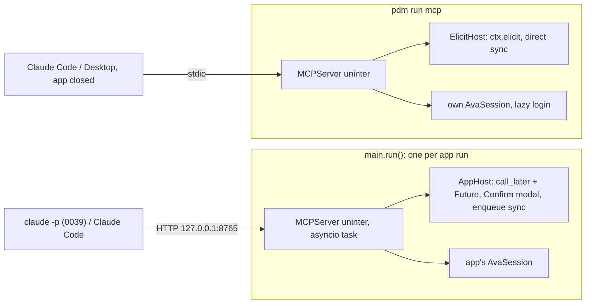

# MCP server

## TL;DR
- `src/api/mcp_server/` builds an `MCPServer` (the `mcp` 2.x SDK) named `uninter` with seven read tools and two actions. Only horários, booking and cancelling reach the AVA; transcrições come from 0037's public CDN.
- `main.py` serves it on streamable HTTP at `http://127.0.0.1:8765/mcp` for the life of each run, in the app's loop and with the app's `AvaSession`, and stops it before the engine goes; the app exposes the URL as `app.mcp_url`.
- `book_prova` and `cancel_agendamento` re-fetch the AVA's agenda and agendamentos, then wait for the student in the TUI's `Confirm` or `ConfirmCancel`, focused on NÃO, before the POST or PUT.
- `pdm run mcp` serves the same tools over stdio when the app is closed, asks through elicitation, and refuses AVA tools while the app is listening.

The chat of 0039 and Claude Code need the student's academic life as tools, and the AVA allows one session at a time. With this spec any MCP client reads what the app already mirrors and books a presencial prova without a second login. Context in [CONTEXT.md](../../CONTEXT.md); booking is [0036](../done/0036-scheduling-presencial-provas.md), transcrições are 0037.

## Observed behaviour
Read in the sources of `mcp` 2.3.0, `uvicorn` 0.54.0 (its pin) and the app's Textual, on 2026-10-24.
- `FastMCP` is now `MCPServer` (`mcp.server.mcpserver`); `Context.elicit`, `streamable_http_app` and `TransportSecuritySettings` exist.
- `uvicorn.Server.serve(sockets=…)` accepts a bound socket. `capture_signals` replaces the SIGINT and SIGTERM handlers on the main thread and re-raises them on the way out.
- Its `shutdown` waits for open connections up to `timeout_graceful_shutdown`, cancels the rest and then runs the lifespan shutdown, which `force_exit` would skip. The streamable GET stream Claude Code keeps open is one such connection.
- `StreamableHTTPSessionManager.run()` can be entered once per instance, and an `MCPServer` keeps one manager.
- `mcp>=2.3,<3` and `uvicorn==0.54.0` resolve together with the project's dependencies (`uv pip compile`, Python 3.12).
- Textual cancels every worker when its message loop ends (`app.py:3465`), before `run_async` returns; nothing can await a graceful stop from there.
- The DNS-rebinding guard compares the `Host` header with its port: `127.0.0.1` alone rejects `127.0.0.1:8765`.
- The app's repositories share one `AsyncSession`, which SQLAlchemy forbids using from two coroutines at once.
- The fake AVA does not answer the login; the tests of 0024 answer it themselves. A logout clears `Credenciais`, so later AVA requests fail with `NotLoggedIn`.

## Decisions

### The server is a task of `main.run`, in the app's loop, stopped before the engine
A second process or thread would need its own `AvaSession`, whose lock and client belong to one loop, and a second login kills the app's session. `run()` binds the socket and starts the server as an asyncio task beside `app.run_async()`, not as a Textual worker: Textual cancels workers before anything can stop them gracefully, and a cancelled `serve()` keeps the port bound into the next run of a reset. Each run builds a new `MCPServer`, since its session manager starts once. When `run_async` returns, `run()` refuses the pending confirmations and sets `should_exit`; uvicorn, configured with `timeout_graceful_shutdown=2`, cancels what still hangs and shuts the session manager down. `run()` awaits the task under a 3 s `wait_for` as a safety net, never `force_exit`, which would skip that shutdown, and only then leaves `db_session` and its engine.

### A logout keeps the server up
Reads keep serving; AVA tools answer "not logged in" until the student logs in again. The reset is the only thing that restarts it, with the run.

### Nine tools, ids in, JSON out
`list_materias()`, `list_atividades(materia_id)` with the `Media`, `list_trabalhos(materia_id)` with entregas, `list_aulas(materia_id)` with atividades and materiais, `get_transcricoes(materia_id, aula_id)`, `list_agendamentos(materia_id)`, `list_horarios(materia_id, atividade_id)`, `book_prova(materia_id, atividade_id, laboratorio_id, inicio)` and `cancel_agendamento(materia_id, agendamento_id)`. Agreed with Prosa and Fita. Reads carry `readOnlyHint`, `cancel_agendamento` `destructiveHint`, and the tools that leave the machine `openWorldHint`. Each read says when the matéria was last synced, since no tool syncs.

### `inicio` is naive Brasília time, to the minute
`list_horarios` returns it and `book_prova` takes it as `YYYY-MM-DDTHH:MM`, enforced by the schema's pattern, because `Horario.inicio` is naive. An offset or a `Z` fails validation instead of comparing aware with naive.

### Only horários and the two actions reach the AVA
Everything else reads the database. `get_transcricoes` calls Fita's `TranscricaoService.of_aula(aula)`, which fetches an aula once from the public CDN, without cookie or `x-time`, so it never logs in; each item carries `material_id`, `titulo`, `ordem`, `texto` and `buscada_em`. A failure becomes a tool error naming the cause: offline, not logged in, or the AVA's `exception`.

### Every tool call builds its services on its own session
`db.py` gains `db_engine()`, which yields the engine after any `schema_is_behind` recreation, and `db_session` is built on it; the engine lives for the run. Each call opens a short `AsyncSession` and builds its repositories, `TranscricaoService` and, over stdio, `AtividadeSyncService` on it; `main.py`'s instances keep the queue's session. Long-lived pieces are shared: the requests, `AvaSession`, and 0037's `TranscricaoRequest` over `public_client`, which sits on a second `FakeAva` because a client closes its transport; stdio composes the same pair. Two calls on the same aula are safe because 0037 upserts per `(material_id, ordem)`. Inference: pysqlite's 5 s busy timeout covers a call landing while the queue commits.

### An action re-checks the AVA before asking
`book_prova` needs a stored atividade that `is_schedulable` now, re-fetches `Paginacao` and refuses if that prova already has a live agendamento, then re-fetches the agenda and books only a horário still `agendavel` with that lab and `inicio`. `cancel_agendamento` re-fetches `Paginacao` and needs that id there, not cancelled, `podeCancelar` and not ended. Any of these fails before the modal opens.

### A TUI modal gates every action inside the app
The server asks a `Host` to `confirm(...)` and to `refresh(materia)`; the model never answers for the student, and the headless chat cannot answer an elicitation. `AppHost` refuses at once, as `o app fechou antes da resposta`, when the app is not mounted and running, before the first screen or after `run_async` returns, since a `call_later` then reaches no message loop. Otherwise it enters the app through `call_later`, pushes the modal with a callback that resolves an `asyncio.Future`, and waits on it. Booking pushes `Confirm` naming prova, matéria, day, hour and, when the agenda has more than one, the lab, as 0036 labels them; cancelling pushes 0036's `ConfirmCancel`. An `asyncio.Lock` shows one at a time. Two minutes without an answer, the call being cancelled, or the run ending dismisses the modal as NÃO, so a late "Sim" never sends anything. `refresh` enqueues the atividades sync, as 0036 does.

### A refusal is a tool error that says who refused and how
So the chat explains instead of looking broken, the tool fails with `Recusado no app: <cause>; nada foi feito.`, the cause being `o aluno escolheu NÃO`, `o aluno fechou a confirmação com esc`, `ninguém respondeu em 2 minutos` or `o app fechou antes da resposta` or `o chat parou antes da resposta`; "nada foi feito" keeps the model from retrying. `Confirm` still hands its callers a bool, and records whether escape closed it so the host can tell the first two apart. Over stdio the prefix is `Recusado no cliente:`. A client killed without cancelling its call leaves the modal to the timeout. `AppHost` lives in `cli/` and its `confirm(modal)` is public, so 0039 tests the modal over its chat without this server. `AppHost.refuse_pending(cause: Recusa)` is public too: `run()` calls it with `Recusa.APP_FECHOU` at shutdown, and the chat with `Recusa.CHAT_PAROU` on ctrl+s, exit and reset, so no modal waits for a dead client. Agreed with Prosa.

### The modal opens over whatever screen is up
A prova, the login or the chat's input lose the keyboard to it, and a stray enter lands on NÃO. That is safe, and an action asked from the chat is expected to need the student's eyes.

### Standalone stdio asks through elicitation and stays off a running app
`pdm run mcp` composes the same server with its own `AvaSession` and the `FakeAva` transport. Before an AVA tool it tries `UNINTER_MCP_HOST:UNINTER_MCP_PORT`; if the app answers, it refuses and names the HTTP URL. Reads never log in; the first AVA tool does, and its description warns that this drops the browser's session. In dev mode the stdio composition, and only it, wraps its `FakeAva` in a transport that answers the login with the mock's usuario, so a mocked matéria books end to end and a real one fails as not logged in instead of logging in. The app's `FakeAva` never answers the login, so dev mode in the app still logs in for real. `ElicitHost` confirms through `ctx.elicit`, refuses when the client lacks elicitation, and refreshes with `AtividadeSyncService.sync`. Nothing writes to stdout but the protocol.

### Settings own the address, and the server binds its own socket
`UNINTER_MCP_HOST` (127.0.0.1) and `UNINTER_MCP_PORT` (8765) join `Settings` and `.env.example`. On `OSError` the app toasts on start and `app.mcp_url` stays `None`. A `uvicorn.Server` subclass makes `capture_signals` a no-op, with `log_config=None` and `access_log=False`; that method is private, so `pyproject.toml` pins `uvicorn==0.54.0` beside `mcp>=2.3,<3` and adds the `mcp` script. The guard's allowed hosts are built from `Settings`, `{mcp_host}:{mcp_port}` and `localhost:{mcp_port}`, so changing the port never answers 421. Assumption: with no token, any local process reads the notas; the actions still need the student's key.

### Tests
Through the SDK's in-memory client, with a fake host and the fake AVA: each tool's JSON; stale horário, booked prova, unschedulable atividade and gone agendamento fail without calling `confirm`; stdio refuses without elicitation and while a port answers. With Pilot, per `novo-teste`: NÃO, escape, the timeout and a cancelled call close the modal and send no POST; Sim books and enqueues the sync; a busy port toasts and leaves `mcp_url` `None`; a run with a confirmation pending stops within the grace time.

## Rejected
- **The stdio server as the only mode.** Claude Code would log in beside the app and drop its session.
- **The server as a Textual worker.** Textual cancels it before a graceful stop, and the port stays bound for the reset's next run.
- **A port chosen at startup.** The student decided on `Settings`, and a fixed URL lets Claude Code keep one `claude mcp add`.
- **A confirmation token the model passes to a second tool.** The model can call both; the student never sees it.
- **Elicitation inside the app.** The headless chat cannot answer it.
- **Syncing from the read tools.** Every sync is AVA traffic the queue already schedules.
- **`src/mcp/` as the package.** It would shadow the SDK's `mcp`.

## What execution corrected
- **The SDK prefixes every tool error.** A refusal reaches the client as `Error executing tool book_prova: Recusado no app: …; nada foi feito.`, so 0039 looks for the sentence inside the text, not at its start.
- **Elicitation needs the handshake-era protocol.** On a 2026-07-28 connection with no back-channel, `ctx.elicit` raises, and `ElicitHost` refuses as `Recusado no cliente: este cliente não sabe pedir confirmação`. Which one Claude Code negotiates over stdio was not checked.
- **`Recusa` lives in `api/mcp_server/host.py` and carries the whole sentence,** since `api` cannot import `cli`; three stdio causes joined the five of the app. `AppHost(app, refresh)` takes the refresh as a callable, so it runs on any `App`.
- **`refuse_pending` also refuses the confirmations queued behind the lock,** and the host only dismisses the modal when it is the top screen: `dismiss` pops whatever is on top.
- **Booking got its own page, `cli/pages/agendar`,** because a bare `Confirm` has no box style; `Confirm` records `closed_with_escape`.
- **`McpListener.bind` listens at once.** With `SO_REUSEADDR`, a bound port that is not listening let a second app bind it too; a test caught it.
- **`MCPServer` installs a Rich handler on the root logger.** `main` gives the root a `NullHandler` first, so nothing is written over the TUI.
- **Read sessions close before any AVA request or modal,** so two minutes of waiting never hold a SQLite read lock against the queue.
- **A 401 from the AVA reads as "não há sessão no AVA".** That is how a session dropped by another login answers.
- **`get_transcricoes` runs against 0037's contract, `of_aula(aula)`, through a protocol,** and a `ValueError` from it is a tool error too, as 0037's review asked. Until the floors meet, `main` and stdio pass `pending_transcricoes`, which answers a tool error.
- **Merge task with 0037.** In `main.py` and `mcp_stdio.py`, `Sources.transcricoes` becomes `lambda session: TranscricaoService(session=session, request=TranscricaoRequest(public_http), repository=TranscricaoRepository(session), aulas=AulaRepository(session))`, and `pending_transcricoes` goes. `main` reuses 0037's `public_client(fake_ava(mocked), log) as public_http`; stdio opens the same pair, a `public_client` on its own `FakeAva` with the four arguments 0037 gave it.
- **`AgendamentoService.fetch` wraps `Paginacao` in the AVA failures,** and `crawler/session.py` names `LOGIN_PATH` for the stdio dev login (`api/mock/offline.py`).
- **Tests also live in `tests/api/mcp_server/`,** although `novo-teste` tests only `cli/`: the MCP is an interface like the TUI, and they assert what the client receives.
- **`UNINTER_MCP_HOST` accepts only `127.0.0.1` or `localhost`,** refused with the reason otherwise: a server with no token must not reach the network. `::1` stays out because the listener binds IPv4.
- **An action before the app opens reads `o app ainda não abriu`.** `AppHost.close()`, called by `run()` after `run_async`, is what turns later refusals into `o app fechou`.
- **A withdrawn modal under another screen closes when uncovered.** `Confirm.withdraw()` dismisses it on top, or on its next `ScreenResume`.
- **The stop never re-raises the server's own failure,** and `from_env` and `stored` moved to `api/credenciais/startup.py`, so stdio no longer imports the Textual app.
- **Every date leaves as naive Brasília time, `YYYY-MM-DDTHH:MM`, declared as a plain string.** Pydantic declared the `datetime` fields as `format: date-time`, which RFC 3339 requires to carry an offset, and Claude rejected `list_materias` for its naive sync times. The `Moment` type serializes to the format `inicio` already used, and a test calls all nine tools and validates each answer against its declared output schema, with `date-time` checked for an offset.
- Verified over a real stdio subprocess in dev mode, against the fake AVA only: the mocked Prova Objetiva listed its horários, and the closed Segunda Chamada was refused.
- Tests: 16 on the tools, 6 on stdio, 3 on HTTP, 2 in-app over HTTP with Pilot, 12 on `AppHost`, 3 on `ConfirmBooking`, 2 on the start toast, 4 on the MCP host setting. `pdm run test` passes, 480 tests; `pdm run ruff check`, `ruff format --check` and `uvx pyright` are clean. The floor has its own `.venv`; `pdm.lock` gained `mcp` 2.3.0 and `uvicorn` 0.54.0.
