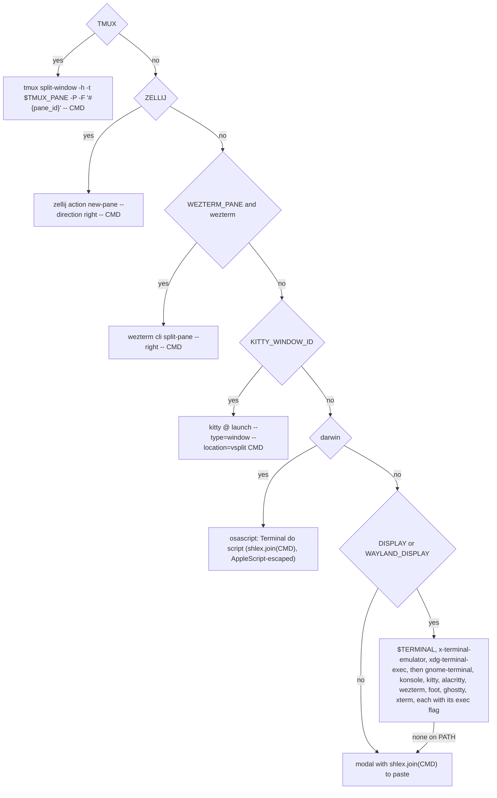

# The tutor is the student's Claude Code terminal

## TL;DR
- `i`, on every page, opens the student's interactive Claude Code beside the app, or focuses it when it is already open. The launcher is a tmux, zellij, WezTerm or kitty split, else a new terminal window, else a command to paste.
- One global conversation for the whole app: the cwd is `settings.chat_dir`, outside the repo, and every launch passes `--continue`.
- `tutor.md` goes in with `--append-system-prompt-file`. The app's MCP server is added next to the student's own MCP servers, and permissions stay the student's, except that `mcp__uninter` is allowed.
- A new MCP tool, `get_current_screen`, asks the page on top what it shows: matéria, tab, and in a prova the open questão as text and the chosen alternativa.
- The `ChatPane` of [0039](../rejected/0039-chat-pane.md) leaves tab 1 and the prova, with the `-p` process and its stream parser. 0039 goes to `rejected/` uncommitted.

The student tried a tutor per screen and asked for one tutor everywhere, without the app rebuilding a chat: literally Claude Code's terminal, where they type commands and do whatever they want with the agent. The app's only job is to open that terminal and keep it informed through the MCP of [0038](./0038-mcp-server.md). [CONTEXT.md](../../CONTEXT.md) keeps 0039's exception about data leaving the machine, reworded for the terminal.

## Observed behaviour
Unless marked, checked on 2026-10-24 with claude 2.1.310, tmux 3.7c and kitty, on Manjaro:
- `claude --help` lists `-c/--continue`, `--append-system-prompt`, `--mcp-config <configs...>` and `--allowedTools <tools...>`, both variadic, so a positional after them is swallowed. It also lists `--strict-mcp-config`, `-n/--name` (shown in the prompt box and the terminal title) and `--system-prompt-snapshot`. The snapshot is on by default and reuses the first request's system prompt on every later launch.
- `--append-system-prompt-file <path>` is accepted although `--help` names it only inside `--bare`'s text. A missing file fails with `Append system prompt file not found`.
- In a folder with no conversation, `claude -c -p` starts a new one instead of failing. That interactive claude does the same is an inference.
- Claude Code sends an http server's `headers` from `--mcp-config` on its POSTs and on the GET stream it keeps open for the session (review of this spec). On a first launch in a new folder, the trust dialog and the login hold that connection back for as long as the student takes.
- A claude started in a folder inside the repo loads the repo's CLAUDE.md, its git status and its code as project context.
- `tmux split-window -h -t "$TMUX_PANE" -P -F '#{pane_id}' -- <argv>` execs the argv directly and prints the pane. Without `-t` it splits the client's active pane. `select-pane -t %id` does not change the active window: focusing takes `select-window -t %id` and `select-pane -t %id`, plus `switch-client -t %id` from another session. `display -p -t %id` fails once the pane is gone.
- `kitty @ launch` takes `--type` and `--location`, and `kitty @ focus-window --match id:N` exists; both need remote control. From documentation, not checked: zellij's `action new-pane`, WezTerm's `cli split-pane` printing a pane id and `cli activate-pane`, kitty printing the new window's id, and macOS Terminal through `osascript`.

## Decisions

### The launcher is chosen by a pure function over the environment
`choose_launcher(env, platform, which)` returns the first launcher that applies. `CMD` is the claude argv below, the same for every launcher:



A launcher that fails, such as kitty without remote control, moves on to the next. Window launchers are spawned with `start_new_session` and stdin, stdout and stderr on `DEVNULL`, so closing the app leaves the terminal alone. The paste modal uses `Copyable`. `i` opens nothing and shows a toast in two cases: no `claude` on the PATH (`Claude Code não está no PATH`), and `app.mcp_url` being `None` (`MCP fora do ar: o Claude não foi aberto`), because `mcp.json` would point at whoever owns the port.

### The claude command is the student's terminal, plus the app's server
```
sh -c 'cd -- "$1" && shift && exec "$@"' sh CHAT_DIR /abs/claude --continue -n uninter
  --mcp-config CHAT_DIR/mcp.json --allowedTools mcp__uninter
  --append-system-prompt-file APP_ROOT/src/cli/lib/claude/tutor.md --system-prompt-snapshot off
```
- The `sh` wrapper sets the cwd inside the argv, so no launcher needs its own cwd flag. Every path is absolute, `claude` included (`installed_claude()`), because a new window does not inherit the app's PATH. The order is fixed so that each variadic flag is followed by another flag; a test locks it.
- `settings.chat_dir` (`UNINTER_CHAT_DIR`, default `~/.local/share/uninter/chat`, in `.env.example`) is outside the repo. A folder inside it would hand the student's tutor the app's own CLAUDE.md and code.
- `--continue` in that fixed cwd makes the latest conversation there the global one, and it follows a `/clear` without the app storing a session id.
- No `--strict-mcp-config`, `--setting-sources`, `--tools` or `--permission-mode`: the student's MCP servers, CLAUDE.md, hooks, skills and permission prompts all apply, because this is their terminal. Only `mcp__uninter` is allowed, so the read tools do not prompt on every question; booking and cancelling still wait for the app's `Confirm` (0038).
- `mcp.json` is written on each launch with `app.mcp_url` and the header `X-Uninter-Client: terminal`. A file keeps the pasted command short.
- `--append-system-prompt-file` keeps Claude Code's own prompt and adds the tutor on top. `--system-prompt-snapshot off` lets an edited `tutor.md` reach a conversation that lives for months. `-n uninter` names the session.

### `i` opens once and then focuses
An ASGI middleware in `McpListener.serving` counts the open GET streams that carry `X-Uninter-Client: terminal`, and `AppHost` reads that count. A terminal is open while the count is above zero. After a launch it also counts as open until the first such stream arrives or until what was launched is gone, with no fixed deadline, since the trust dialog can take any time. "Gone" means a failing `display -p -t` for tmux, a missing id for WezTerm and kitty, or the exited process for a window launcher. A launcher that hands off to a server (gnome-terminal, osascript, zellij) is gone as soon as its client exits. There, a second `i` while claude starts can open a second terminal; that risk is accepted. The paste modal opens nothing, so nothing counts as open after it. `i` with a terminal open focuses it when the launcher returned an id: tmux `select-window` and `select-pane`, with `switch-client` from another session; WezTerm `activate-pane`; kitty `focus-window --match id:N`. Otherwise it shows the toast `O Claude já está aberto em outra janela`. `i` is an app binding (`claude`) on every page except login, and typing in an `Input` never triggers it.

### The model pulls the screen through `get_current_screen`
The tool takes no arguments and returns `CurrentScreenView`: the page (`materias`, `prova`, `agendar`), the matéria (`id`, `nome`, `periodo`), on the matérias page the active tab, and in a prova the atividade, the questão (`ordem`, total, statement and alternativas as plain text) and the alternativa marked, or the summary once handed in.

`AppHost.current_screen()` walks `app.screen_stack` from the top and asks the first page that implements `current_screen()`. That runs in the app's loop on every call, so the answer is always current and nothing has to be kept in sync while the student navigates. Under `pdm run mcp` the tool answers that the app is closed. `tutor.md` tells the model to call the tool when the student says "esta questão" or "esta matéria", not on every turn.

### What of 0039 survives
**Survives:** `tutor.md`, rewritten as an appendix that drops `Contexto do aplicativo neste momento:` and the narrow-panel advice and gains `get_current_screen`; `installed_claude`, `mcp_config` (now with the header), `SERVER` and `TUTOR_PROMPT`, moving with the launchers from `assistant.py` to `cli/lib/claude/terminal.py`; `context.py`'s html-to-text formatting of the questão, which now fills `CurrentScreenView`; the CONTEXT.md exception, reworded.

**Goes:**
- `ChatPane` and `introduction.py`; `Conversation`, `Tutor` and `ClaudeAssistant.ask` with its arguments; the stream parser and `stream.jsonl`; `ScriptedAssistant` and `fake_claude.py`.
- The `focus_chat` binding and its `check_action` on both pages, `fit_under` and the chat's CSS, the `assistant` parameter of the app, `tests/launched.py` and `tests/doubles.py`, `Tutor.close` on unmount, and `APP_ROOT/.chat` with its 0039 `-p` sessions and `.gitignore` line.
- `Recusa.CHAT_PAROU` with `refuse_chat_confirmations`: a claude closed mid-confirmation cancels its call, which 0038 already refuses. `test_mcp_host.py` switches to `APP_FECHOU`.
- The tests: `test_stream.py`, `test_tutor.py` and both chat page tests go; `test_assistant.py` and `test_context.py` are rewritten.

### Tests never open a terminal
Via `novo-teste`:
- `choose_launcher`, parametrized over env, platform and a fake `which`, asserting the chosen launcher and its argv, the fallbacks included.
- The claude argv in its locked order, the `sh` wrapper and `mcp.json` for a given `mcp_url` and chat folder; the pasted line round-trips through `shlex.split`.
- `get_current_screen` through `AppHost` after driving pages with Pilot: matéria, tab, questão and alternativa follow the student, and the page on top answers.
- `i` with a recording launcher: the first press opens, a press during the wait or with a stream open focuses, a gone pane opens again, and with `mcp_url` `None` nothing opens.

## Rejected
- **Keeping 0039's pane next to the terminal.** Two chats with two histories, and the student asked for one.
- **`-p` with a chat rebuilt in the TUI.** It is the feature-by-feature rebuild the student refused: no slash commands, no permissions, no file tools.
- **Context in `--append-system-prompt`.** It is frozen at launch, and the screen changes after that.
- **Pages pushing their state to the app.** Every navigation path has to remember to publish; pulling from the page on top cannot go stale.
- **The chat folder inside the repo with `--setting-sources ""`.** It would cut the student's own setup out of their own terminal to hide the repo's.
- **A stored session id with `--resume`.** It would lose the conversation that a `/clear` starts, and `--continue` in a fixed cwd already finds it.
- **Running claude inside the TUI, with a pty in a Textual widget.** It means a terminal emulator to maintain, when the student already has a real terminal.
- **Closing the terminal when the app exits.** It belongs to the student. Its `uninter` tools fail until the app is running again.

## What execution corrected
- **Interactive `claude --continue` fails with no conversation.** It prints `No conversation found to continue` and exits 1. The first launch in a new folder only seemed to work because the trust dialog comes before that check. The wrapper now runs `"$@" --continue || "$@"`: it continues when there is a conversation and starts one when there is not. Not checked: a claude that exits non-zero after a real session also starts a fresh one in the same pane.
- **There is no GET stream to count.** Claude Code 2.1.310 sent five POSTs carrying `X-Uninter-Client: terminal` and never a GET, and the server sent back no `mcp-session-id`. The middleware and the header are gone. Instead, the wrapper writes its PID to `chat_dir/claude.pid`, stays the parent of claude and removes the file at the end. The terminal counts as open while that process lives.
  - This works the same for every launcher, so gnome-terminal, zellij and osascript no longer risk a second Claude. A Claude started by hand with the pasted command counts too.
  - The pane probes and the tracking of window processes went away with it.
  - Cost: a terminal killed outright leaves the file behind, and a reused PID would read as open until that process ends.
- **tmux's `display -p -t` on a closed pane exits 0**, while `has-session -t` fails. This was measured before the probes were dropped.
- **tmux focus runs `select-window`, then `select-pane`, then `switch-client`.** tmux stops a chain at the first failing command, and `switch-client` fails when no client is attached.
- **The environment goes through `TerminalEnvironment`**, a `BaseSettings` in `settings.py` documented in `.env.example`, as the repo's env rule demands. `choose_launchers(env, platform, which)` returns the whole chain: every split that applies plus one window. The opener tries them in order and falls back to the paste modal.
- **`agendar` is not a page.** It is the `ConfirmBooking` modal, which the walk skips. Only `MateriasPage` and `ProvaPage` answer, and with neither on the stack the page is `nenhuma`. `CurrentScreenView` also carries the atividade highlighted in tab 1. The prova block carries `respostas` for every questão, always, and `entregue`.
- **`Copyable` is tied to JSON**, so the paste modal `ClaudeCommand` copies with `c` through the app's `copy_to_clipboard`, handed to it.
- **Three modules instead of one `terminal.py`**: `terminal.py` (the command, `mcp.json`, the PID file), `launchers.py` (the pure chain) and `opener.py` (`ClaudeTerminal`, `SystemShell`).
- **The real test ran outside the TUI's dev mode.** That mode only seeds a fake matéria, and the real ones still go to the AVA. So a harness ran the real `UninterApp` over the tests' fake AVA (MockTransport, temporary database and config), with the real MCP server on a free port, in a detached tmux on its own socket.
  - `i` split a pane, the fallback started a conversation, and `/mcp` listed `uninter` with 10 tools.
  - A second `i` focused the pane.
  - `get_current_screen` answered `materias` / Engenharia de Software / `atividades` with no permission prompt.
  - A new chat folder asks for trust on the first launch.
- **`painted_toasts` moved to `tests/doubles.py`** on its second caller.
