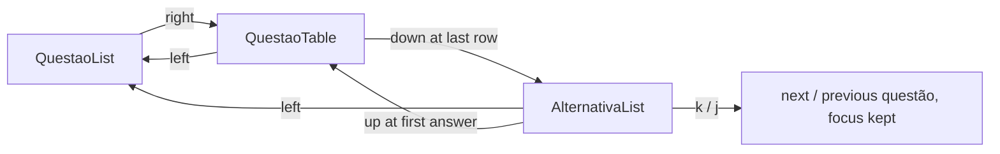

# Tables as tables

## TL;DR
- `html_to_markup` becomes `html_to_blocks`, returning `Prose` and `Table` instead of one string.
- `#prova-text` becomes `#prova-blocks`: one widget per block, a `QuestaoTable` for each `Table`.
- Tables join the step chain between `QuestaoList` and `AlternativaList`; `a`–`h` keep answering from inside one.
- `<th>` names the header row; with no `<th>`, the first row is the fallback.
- The questão preview reads the first block instead of parsing the enunciado a second time.

A questão carries real AVA HTML, and a `<table>` in it is flattened to space-padded lines
inside a `Static` — legible by luck, and only while the columns stay narrow. This builds on
the library [0026](0026-html-to-textual.md) creates, and is measured against the funcionário
table in the mocked prova of [0023](../../done/0023-dev-mode.md).

## Observed behaviour
- Screen-level `a`–`h` bindings still fire while a `DataTable` holds focus — verified with a Textual `run_test` probe; the keys bubble past the table.
- `DataTable` binds `up`, `down`, `left`, `right`, `enter`, `home`, `end`, `pageup`, `pagedown`, `ctrl+home` and `ctrl+end`, and no letters — read from `DataTable.BINDINGS`.
- The AVA sends the header row as `<td>`: the funcionário table in the APOL payload has no `<th>` and no `<thead>`.
- `` is dropped silently, tag and `alt` together — left alone here, sketched in [asciifying images](../../asciifying-images.sketch.md).

## Decisions

### The library returns blocks, and the page turns them into widgets
`html_to_blocks(html) -> list[Block]` yields `Prose`, a markup string, and `Table`, rows plus
an optional header. Nothing under `lib/` imports a widget, so the parser stays testable
without a running app and focus, CSS and mounting stay with the page, where
[0018](../../done/0018-pages-and-their-components.md) puts them.

### Down leaves a component, right belongs to it
`QuestaoTable` is `Steps` in front of `DataTable`, like the `TrabalhoTable` of
[0011.1](../../done/0011.1-trabalhos-tab.md) under [0016.6](../../done/0016.6-pane-navigation.md).

`right` inside a component is the component's own — the table scrolls with it — so `down` is
what moves on, and only a table with rows to walk takes focus at all.

### `<th>` names the header, the first row is only the fallback
Faithful first: a `<th>` or a `<thead>` decides. Only when the table has neither does the
first row become the header, which is what the AVA's own tables need. The cost is a
two-column "relacione as colunas" table losing its first pair to a header rule; that is
accepted, and it is why the fallback is a fallback.

### The preview reads the first block, not the HTML again
The sidebar takes the first line of the first `Prose` block instead of parsing the enunciado
again with `html_to_text`, so a questão that opens with a table stops previewing as a run of
cells. Blocks are built once per questão and reused by both the sidebar and the body, which
keeps the bargain [0022](../../done/0022-repainting-less.md) made.

## Rejected
- **A Rich `Table` inside the existing `Static`.** Cheaper, and no focus to thread, but a wide table could then only be read by resizing the terminal — a `DataTable` scrolls.
- **Treating every first row as a header.** Right for the funcionário table, wrong for the association tables, and it guesses where the HTML is explicit.
- **Keeping `html_to_markup` beside `html_to_blocks`.** Two ways to render the same HTML would drift; the string version has no caller left once the page mounts blocks.

## What execution corrected
- **`questao_row` takes the preview as an argument.** Reading it off the blocks inside the row would have parsed all ten questões through bs4 on every answer, since the sidebar rebuilds every row each time. The page memoises blocks by questão id and passes the line down, which is what "one parse per questão" was supposed to buy.
- **`show()` became async.** Mounting a widget per block is awaited, so the questão-list handler that calls it had to become async too.
- **The `<th>` rule is an index, not a flag.** `header_index` returns the first row holding a `<th>`, and that row leaves the body — which puts the explicit case and the first-row fallback on one path instead of two.
- **Two stylesheet rules were needed.** `#prova-blocks` is a `Vertical`, which defaults to `1fr` and had to be `height: auto` to size to its content inside the scroll; `QuestaoTable` needed `height: auto` with `max-height: 16` so a long table cannot eat the pane.
- **The answers' cursor follows focus, and only a chosen answer outlives it.** Highlighting the first option always made the prova look pre-answered before it was even opened; highlighting nothing made the pane look unfocused once `right` reached it, because `#prova-alternativas` paints no border of its own, so the cursor was the only cue it had. The list takes a cursor when it gains focus, drops it on blur, and keeps the chosen option at both. Answered is still the `●` mark, never the bar.
- **`down` leaves a table at its last row, `up` goes back in at the first answer.** `Steps` knew only `left`, `right` and `up`, so a table dead-ended at its bottom and the answers had no `up` of their own. `Steps` grew a `STEP_DOWN` edge, which `QuestaoTable` decides by cursor position rather than scroll, since a `DataTable` moves a cursor where a scrolling widget moves its viewport.
- **`right` never leaves a focusable component, and no longer changes questão either.** It first belonged to the step chain, moving on to the next table or the answers, then briefly to the next questão. It is the component's own key now — the table scrolls a wide one with it — so `down` is the only way forward and `left` from the answers always returns to the list. Changing questão became `k` and `j`, screen bindings that hold focus where it already is.
- **A table with nothing to walk does not take focus.** A `<table>` with a header and no body rows still mounted a focusable widget, so `right` stopped on a dead end. `can_focus` follows the row count now, and the page steps through `navigable_tables()`. The funcionário table was rendered in the running app to confirm the real one still fits: 7 columns in 72 cells.
